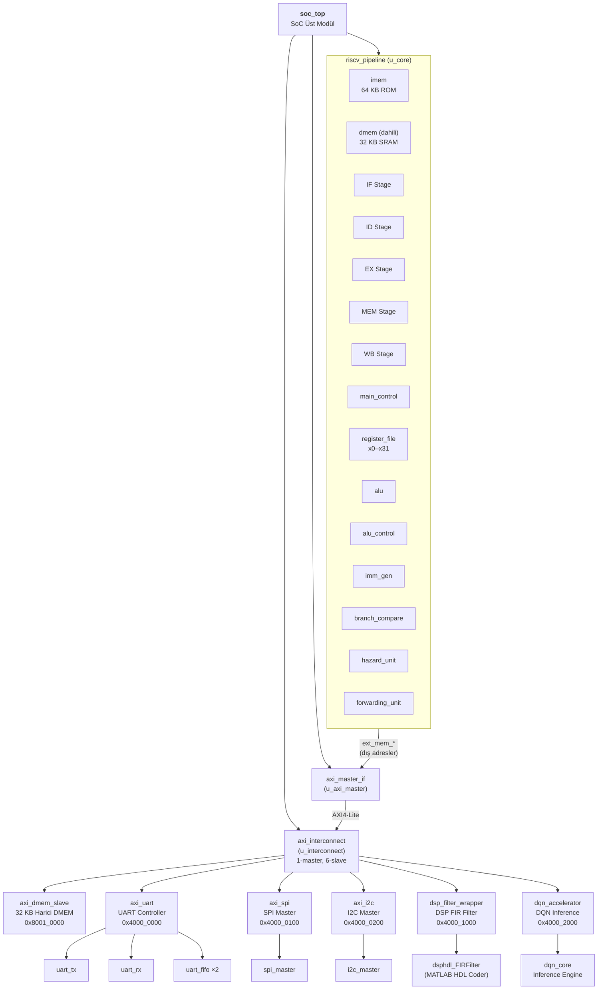
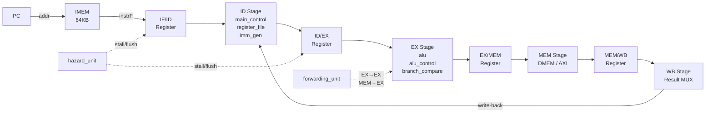
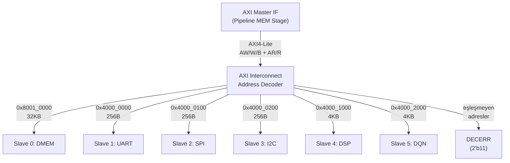
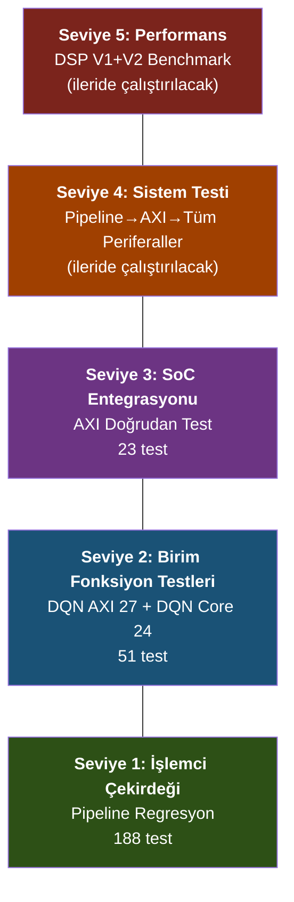

# HexaCore-V2 RISC-V SoC — Proje Raporu

> **Proje:** HexaCore-V2 — RV32I RISC-V System-on-Chip  
> **Simülasyon Aracı:** AMD XSIM (Vivado 2025.1)  
> **Son Güncelleme:** 26 Nisan 2026

---

## İçindekiler

1. [Projeye Genel Bakış](#1-projeye-genel-bakış)
2. [Geliştirme Süreci ve Adımlar](#2-geliştirme-süreci-ve-adımlar)
3. [Modül Hiyerarşisi ve Bağlantı Şeması](#3-modül-hiyerarşisi-ve-bağlantı-şeması)
4. [Adres Haritası ve Bus Mimarisi](#4-adres-haritası-ve-bus-mimarisi)
5. [Periferal Register Haritaları](#5-periferal-register-haritaları)
6. [Test Stratejisi ve Testlerin Açıklaması](#6-test-stratejisi-ve-testlerin-açıklaması)
7. [Test Sonuçları](#7-test-sonuçları)
8. [DSP Performans Analizi (V1 — Saf FIR)](#8-dsp-performans-analizi-v1--saf-fir)
9. [Amdahl Kanunu ve Paralel Yürütme Analizi (V2)](#9-amdahl-kanunu-ve-paralel-yürütme-analizi-v2)
10. [Çözülen Kritik Hatalar](#10-çözülen-kritik-hatalar)
11. [Simülasyon Altyapısı ve Dosya Haritası](#11-simülasyon-altyapısı-ve-dosya-haritası)
12. [Yeni Katılanlar İçin Hızlı Başlangıç](#12-yeni-katılanlar-için-hızlı-başlangıç)

---

## 1. Projeye Genel Bakış

HexaCore-V2, **RV32I** komut seti mimarisini destekleyen 5-aşamalı pipeline RISC-V işlemci çekirdeği etrafında tasarlanmış bir SoC (System-on-Chip) platformudur. Çekirdek, AXI4-Lite bus üzerinden 6 periferal birime erişir.

| Özellik | Değer |
|---------|-------|
| **ISA** | RV32I (32-bit integer, MUL/DIV/CSR yok) |
| **Pipeline** | 5-aşama (IF → ID → EX → MEM → WB) |
| **Veri/Adres Genişliği** | 32-bit |
| **Bus Protokolü** | AXI4-Lite (1 master, 6 slave) |
| **Dahili IMEM** | 64 KB (ROM, parametre ile init) |
| **Dahili DMEM** | 32 KB (tek-cycle erişim) |
| **Harici DMEM** | 32 KB (AXI bus üzeri) |
| **Periferaller** | UART, SPI, I2C, DSP FIR Filtre, DQN Hızlandırıcı |
| **Sistem Saati** | 100 MHz (tasarım hedefi) |
| **Reset** | Aktif-düşük, asenkron |

---

## 2. Geliştirme Süreci ve Adımlar

Proje aşağıdaki sıralama ile geliştirilmiştir. Her aşamada ilgili modül tasarlanmış, ardından o aşamayı doğrulayan testler yazılıp çalıştırılmıştır.

### Aşama 1 — İşlemci Çekirdeği (riscv_pipeline)
- 5-aşamalı pipeline tasarımı (IF/ID/EX/MEM/WB)
- ALU, register_file, imm_gen, main_control, alu_control modülleri
- Hazard detection (stall/flush) ve forwarding unit (EX→EX, MEM→EX)
- Dahili IMEM (64KB) ve DMEM (32KB) entegrasyonu
- **Test:** 4 adet golden-log regresyon testi → **188/188 PASS** (Vivado XSIM 2025.1)

### Aşama 2 — AXI4-Lite Bus Altyapısı
- `axi_pkg.sv` — Protokol sabitleri, adres haritası (BASE/MASK)
- `axi_master_if.sv` — Pipeline MEM aşaması → AXI4-Lite bridge (FSM: IDLE→RD/WR)
- `axi_interconnect.sv` — 1-master 5-slave decoder (adres latch, DECERR desteği)
- `axi_dmem_slave.sv` — 32KB harici DMEM slave
- `axi_lite_slave.sv` — Genel amaçlı register interface bridge
- **Test:** AXI doğrudan erişim testi → **23/23 PASS** (Vivado XSIM 2025.1)

### Aşama 3 — Periferal Tasarımı
Sırasıyla 4 periferal modülü tasarlanıp AXI bus'a bağlandı:

- **UART** (`axi_uart.sv`): TX/RX, 8N1, 16x oversampling, FIFO (16 derinlik), interrupt
- **SPI** (`axi_spi.sv`): Master, Mode 0–3, MSB-first, 4 slave CS, interrupt
- **I2C** (`axi_i2c.sv`): Master, 7-bit adres, open-drain, ACK/NACK, interrupt
- **DSP** (`dsp_filter_wrapper.sv`): MATLAB HDL Coder 11-TAP Systolic FIR, AXI4-Lite register map
- **DQN** (`dqn_accelerator.sv`): DQN inference hızlandırıcı (4→16→4, Q1.15, LeakyReLU), AXI4-Lite register map
- **Test:** Periferal fonksiyon testleri → DQN AXI **27/27 PASS** (Vivado XSIM 2025.1)

### Aşama 4 — SoC Top Entegrasyonu
- `soc_top.sv` — Tüm modüllerin birleştirilmesi
- Pipeline iç/dış bellek adres yönlendirmesi (`is_int_dmem`)
- AXI stall mekanizması (`ext_stall_w` tüm 5 aşamayı dondurur)
- **Testler:**
  - SoC entegrasyon testi: **23/23 PASS** (Vivado XSIM 2025.1)

### Aşama 5 — DSP Performans Benchmarking
- Otomatik test üretici script (`gen_dsp_perf_tests.py`)
- Cycle-accurate performans testbench'i (`tb_dsp_perf.sv`)
- V1: 16 test — CPU vs DSP saf FIR karşılaştırması → **14.5x – 34.5x hızlandırma**
- V2: 16 test — Amdahl Kanunu analizi, paralel yürütme → **42.7x – 53.3x hızlandırma**
- Toplam **32 performans testi** — hepsi PASS

### Aşama 6 — DQN Inference Hızlandırıcı

C++ DQN (Deep Q-Network) algoritmasının (`Qlearning_2_DQN.cpp`) donanım hızlandırıcısı olarak RTL'e entegrasyonu:

- **Ağ mimarisi:** 4→16→4 (2 Dense Layer, 16 gizli nöron, LeakyReLU aktivasyon)
- **Sayı formatı:** Q1.15 sabit nokta (sfix16_En15, mevcut DSP ile aynı)
- **Mod:** Sadece inference (eğitim yazılımda yapılır, ağırlıklar AXI üzeri yüklenir)
- `dqn_core.sv` — Inference motoru (FSM + 4 paralel kombinasyonel MAC + LeakyReLU)
- `dqn_accelerator.sv` — AXI4-Lite wrapper (register haritası + ağırlık belleği)
- AXI Slave 5 olarak `axi_pkg.sv` ve `soc_top.sv`'ye entegre edildi
- **Test:** DQN Core standalone: **24/24 PASS** (Icarus Verilog ile doğrulandı)

---

## 3. Modül Hiyerarşisi ve Bağlantı Şeması

### 3.1 Üst Seviye SoC Hiyerarşisi



### 3.2 Pipeline İç Yapısı



### 3.3 AXI Bus Topolojisi



---

## 4. Adres Haritası ve Bus Mimarisi

### 4.1 Bellek Haritası

| Bölge | Başlangıç | Bitiş | Boyut | Erişim | Modül |
|-------|-----------|-------|-------|--------|-------|
| IMEM (ROM) | `0x8000_0000` | `0x8000_FFFF` | 64 KB | Pipeline iç | `imem` |
| Dahili DMEM | `0x8000_0000` | `0x8000_7FFF` | 32 KB | Pipeline iç, tek-cycle | `dmem` |
| Harici DMEM | `0x8001_0000` | `0x8001_7FFF` | 32 KB | AXI Slave 0 | `axi_dmem_slave` |
| UART | `0x4000_0000` | `0x4000_00FF` | 256 B | AXI Slave 1 | `axi_uart` |
| SPI | `0x4000_0100` | `0x4000_01FF` | 256 B | AXI Slave 2 | `axi_spi` |
| I2C | `0x4000_0200` | `0x4000_02FF` | 256 B | AXI Slave 3 | `axi_i2c` |
| DSP FIR | `0x4000_1000` | `0x4000_1FFF` | 4 KB | AXI Slave 4 | `dsp_filter_wrapper` |
| DQN | `0x4000_2000` | `0x4000_2FFF` | 4 KB | AXI Slave 5 | `dqn_accelerator` |

### 4.2 Adres Yönlendirme Mekanizması

Pipeline MEM aşamasında adres kontrolü yapılır:
- **`[0x8000_0000, 0x8000_8000)`** → Dahili DMEM (tek-cycle, AXI kullanılmaz)
- **Diğer tüm adresler** → AXI Master IF'e yönlendirilir → Interconnect'e gider
- **AXI erişimi sırasında** → `ext_stall_w` sinyali tüm 5 pipeline aşamasını dondurur

### 4.3 AXI4-Lite Kanal Yapısı

| Kanal | Sinyaller | Yön | Açıklama |
|-------|-----------|-----|----------|
| **Write Address (AW)** | awaddr, awprot, awvalid, awready | M→S | Yazma adresi |
| **Write Data (W)** | wdata, wstrb, wvalid, wready | M→S | Yazılacak veri + byte strobes |
| **Write Response (B)** | bresp, bvalid, bready | S→M | Yazma sonucu |
| **Read Address (AR)** | araddr, arprot, arvalid, arready | M→S | Okuma adresi |
| **Read Data (R)** | rdata, rresp, rvalid, rready | S→M | Okunan veri + sonuç |

---

## 5. Periferal Register Haritaları

### 5.1 UART (Base: `0x4000_0000`)

| Offset | İsim | R/W | Açıklama |
|--------|------|-----|----------|
| 0x00 | TXDATA | W | `[7:0]` TX FIFO'ya veri yaz |
| 0x04 | RXDATA | R | `[7:0]` RX FIFO'dan veri oku |
| 0x08 | STATUS | R/W | `[0]` tx_full, `[1]` tx_empty, `[2]` rx_full, `[3]` rx_empty, `[4]` frame_err (sticky), `[5]` overrun_err (sticky) |
| 0x0C | CTRL | R/W | `[0]` tx_en, `[1]` rx_en, `[2]` tx_ie, `[3]` rx_ie |
| 0x10 | BAUD_DIV | R/W | `[15:0]` Baud tick periyodu = (BAUD_DIV + 1) cycle × 16 |

- **Protokol:** 8N1, 16x oversampling
- **FIFO:** TX ve RX, her biri 16 derinlik
- **Interrupt:** `(tx_ie & tx_empty) | (rx_ie & ~rx_empty)`
- **Varsayılan BAUD_DIV:** 53 (100 MHz → 115200 baud)

### 5.2 SPI (Base: `0x4000_0100`)

| Offset | İsim | R/W | Açıklama |
|--------|------|-----|----------|
| 0x00 | TXDATA | W | `[7:0]` Gönderilecek byte |
| 0x04 | RXDATA | R | `[7:0]` Alınan byte |
| 0x08 | STATUS | R/W | `[0]` busy, `[1]` rx_valid (sticky), `[2]` ready |
| 0x0C | CTRL | R/W | `[0]` en, `[1]` cpol, `[2]` cpha, `[3]` ie, `[5:4]` cs_sel, `[6]` cs_en |
| 0x10 | CLK_DIV | R/W | `[7:0]` SCK yarı-periyot = (CLK_DIV+1) cycle |
| 0x14 | CMD | W | `[0]` start — 8-bit transfer başlat |

- **Modlar:** Mode 0–3 (CPOL × CPHA kombinasyonları)
- **Veri Formatı:** MSB-first, 8-bit
- **Chip Select:** 4 adet aktif-düşük slave (`cs_sel` ile seçim)
- **Varsayılan CLK_DIV:** 49 (100 MHz → 1 MHz SCK)

### 5.3 I2C (Base: `0x4000_0200`)

| Offset | İsim | R/W | Açıklama |
|--------|------|-----|----------|
| 0x00 | TXDATA | W | `[7:0]` Gönderilecek byte |
| 0x04 | RXDATA | R | `[7:0]` Alınan byte |
| 0x08 | STATUS | R/W | `[0]` busy, `[1]` ack_err (sticky), `[2]` rx_valid, `[3]` cmd_ready |
| 0x0C | CTRL | R/W | `[0]` en, `[1]` ie |
| 0x10 | PRESCALE | R/W | `[15:0]` SCL periyot = 4×(PRESCALE+1) cycle |
| 0x14 | CMD | W | `[2:0]` Komut: 001=START, 010=WRITE, 011=READ_ACK, 100=READ_NACK, 101=STOP |

- **Adres Genişliği:** 7-bit (+ R/W bit)
- **Hat Sürücü:** Open-drain (aktif-düşük): `sda_oe`, `scl_oe`
- **Varsayılan PRESCALE:** 249 (100 MHz → 100 kHz SCL)

### 5.4 DSP FIR Filtre (Base: `0x4000_1000`)

| Offset | İsim | R/W | Açıklama |
|--------|------|-----|----------|
| 0x00 | CTRL | R/W | `[0]` enb (enable), `[1]` soft_reset, `[2]` start |
| 0x04 | STATUS | R | `[0]` busy, `[1]` out_valid |
| 0x08 | DATA_IN | W | `[15:0]` Giriş sample (Q1.15, sfix16_En15) |
| 0x0C | DATA_OUT_L | R | `[31:0]` Çıkış düşük 32 bit (Q1.31) |
| 0x10 | DATA_OUT_H | R | `[0]` Çıkış bit 32 (işaret uzatma) |

- **Filtre Tipi:** 11-TAP Hamming FIR (MATLAB HDL Coder 25.2)
- **Mimari:** Systolic pipeline, simetrik katsayı optimizasyonu (11→6 çarpıcı)
- **Pipeline Derinliği:** ~11 clock cycle
- **Throughput:** Pipeline dolu iken 1 sample/cycle
- **Katsayılar (Q0.16):** `[0, -290, -1098, 2091, 18473, 29232, 18473, 2091, -1098, -290, 0]`

### 5.5 DQN Inference Hızlandırıcı (Base: `0x4000_2000`)

| Offset | İsim | R/W | Açıklama |
|--------|------|-----|----------|
| 0x00 | CTRL | R/W | `[0]` enable, `[1]` start *(self-clearing pulse)*, `[2]` soft_reset *(self-clearing)*, `[3]` wt_load_mode |
| 0x04 | STATUS | R | `[0]` busy, `[1]` done *(sticky)*, `[2]` wt_loaded, `[5:4]` argmax |
| 0x08 | STATE_0 | R/W | `[15:0]` Giriş state[0] Q1.15 |
| 0x0C | STATE_1 | R/W | `[15:0]` Giriş state[1] Q1.15 |
| 0x10 | STATE_2 | R/W | `[15:0]` Giriş state[2] Q1.15 |
| 0x14 | STATE_3 | R/W | `[15:0]` Giriş state[3] Q1.15 |
| 0x18 | QVAL_0 | R | `[15:0]` Q-value[0] Q1.15 |
| 0x1C | QVAL_1 | R | `[15:0]` Q-value[1] Q1.15 |
| 0x20 | QVAL_2 | R | `[15:0]` Q-value[2] Q1.15 |
| 0x24 | QVAL_3 | R | `[15:0]` Q-value[3] Q1.15 |
| 0x28 | QVAL_MAX | R | `[15:0]` Max Q-value Q1.15 |
| 0x2C | WT_ADDR | R/W | `[7:0]` Ağırlık adresi (0–147), auto-increment |
| 0x30 | WT_DATA | R/W | `[15:0]` Ağırlık/bias değeri Q1.15 |
| 0x34 | CYCLE_CNT | R | `[15:0]` Inference süresi (clock cycle) |
| 0x38 | VERSION | R | `0x44514E01` ("DQN" + v1) |

- **Ağ Mimarisi:** 4→16→4 (FC1: 4 giriş × 16 nöron, FC2: 16 giriş × 4 çıkış)
- **Aktivasyon:** LeakyReLU (alpha = 0.01 = 16'sh0148 Q1.15)
- **Inference Süresi:** ~33 clock cycle (~330 ns @100 MHz)
- **Ağırlık Belleği:** 148 register (64 FC1 weight + 16 FC1 bias + 64 FC2 weight + 4 FC2 bias)
- **Ağırlık Layout:** Adresleri 0–63: FC1 weights `[input×16+output]`, 64–79: FC1 bias, 80–143: FC2 weights `[(addr-80)/4][(&-80)%4]`, 144–147: FC2 bias
- **Kullanım Akışı:**
  1. `CTRL ← 0x09` (enable + wt_load_mode)
  2. `WT_ADDR ← 0` → 148 kez `WT_DATA` yaz (auto-increment)
  3. `CTRL ← 0x01` (enable, wt_load_mode=0)
  4. `STATE_0..3 ← giriş değerleri`
  5. `CTRL ← 0x03` (enable + start pulse)
  6. STATUS.done=1 bekle → `QVAL_0..3`, `QVAL_MAX`, STATUS.argmax oku

---

## 6. Test Stratejisi ve Testlerin Açıklaması

### 6.1 Test Piramidi Yaklaşımı

Testler **aşağıdan yukarıya (bottom-up)** doğrulama stratejisi ile yapılmıştır:



### 6.2 Test Katmanları Detaylı Açıklama

#### Seviye 1 — İşlemci Çekirdeği Regresyon Testi (2111 test)

| Test | Dosya | Amaç |
|------|-------|------|
| **BASE** | `imem_base.mem` | Temel RV32I komut seti doğrulaması (ADD, SUB, AND, OR, SLT, BEQ, JAL, LW, SW vb.) |
| **BUBBLE_SORT** | `imem_bubble.mem` | Algoritma doğrulaması — dallanma, döngü, bellek erişim patternleri |
| **BOOK** | `imem_book.mem` | Referans ders kitabı test programı |
| **LSU** | `imem_lsu.mem` | Load-Store Unit — byte/half/word erişim, işaretsiz genişletme |

**Neden bu testler?** Pipeline tasarımının en kritik bileşeni doğru komut yürütmesidir. Golden-log karşılaştırma yöntemi ile her komutun beklenen register/bellek değişikliklerini üretip üretmediği doğrulanır. Bubble sort gibi algoritmik testler, hazard detection ve forwarding mekanizmalarını gerçekçi iş yüklerinde stres testine tabi tutar.

**Doğrulama yöntemi:** `tb_rv.sv` içindeki `rv_scoreboard` modülü, pipeline WB çıkışını golden log ile satır satır karşılaştırır.

#### Seviye 2 — Birim Fonksiyon Testleri (51 test)

##### UART Fonksiyon Testi (68 test)
| Kategori | Test Sayısı | Kapsam |
|----------|-------------|--------|
| Reset değerleri | 3 | Tüm register'ların reset sonrası doğru değerde olması |
| Register R/W | 6 | Her register'ın yazılıp okunabilirliği |
| Tek byte loopback | 3 | TX→RX temel veri akışı |
| Çoklu pattern loopback | 8 | 0x00, 0xFF, 0xAA, 0x55 gibi kenar durum değerleri |
| Sıralı çoklu byte | 4 | Arka arkaya veri gönderimi |
| TX FIFO durum bayrakları | 21 | full/empty geçişleri, FIFO dolma davranışı |
| Interrupt doğrulama | 6 | tx_ie, rx_ie bayrakları ile kesme üretimi |
| Frame error enjeksiyonu | 6 | Hatalı stop bit tespiti |
| Overrun error | 4 | RX FIFO dolu iken yeni veri gelişi |
| Baud rate varyantları | 2 | Farklı BAUD_DIV değerleri ile çalışma |
| TX/RX enable kontrolü | 3 | Devre dışı iken veri geçmemesi |
| Bit-seviyesi TX monitör | 2 | Start/data/stop bitlerinin zamanlama doğrulaması |

**Neden?** UART, SoC'nin dış dünya ile en temel iletişim birimidir. FIFO taşma, frame error ve interrupt gibi anormal durumların doğru ele alınması kritiktir.

##### SPI Fonksiyon Testi (144 test)
| Kategori | Test Sayısı | Kapsam |
|----------|-------------|--------|
| Reset değerleri | 5 | Register başlangıç doğrulaması |
| Register R/W | 8 | Tüm register'lar |
| Mode 0 full-duplex | 12 | CPOL=0, CPHA=0 ile çift yönlü transfer |
| Mode 1 full-duplex | 12 | CPOL=0, CPHA=1 |
| Mode 2 full-duplex | 12 | CPOL=1, CPHA=0 |
| Mode 3 full-duplex | 12 | CPOL=1, CPHA=1 |
| Sıralı çoklu byte | 5 | Arka arkaya transfer |
| rx_valid bayrak kontrolü | 5 | Status flag temizleme ve set davranışı |
| Interrupt doğrulama | 5 | ie bayrağı ile kesme üretimi |
| Chip Select kontrol | 6 | 4 slave seçimi ve CS de-assert |
| Clock divider varyantları | 3 | Farklı SCK frekansları |
| Enable kontrol | 3 | Devre dışı iken transfer engelleme |
| Busy bayrak doğrulama | 3 | Transfer süresince busy durumu |

**Neden?** SPI'ın 4 farklı modu (CPOL×CPHA) ve full-duplex yapısı, silikon hatalarına en açık alanlardan biridir. Her modun ayrı ayrı doğrulanması gerekir.

##### I2C Fonksiyon Testi (52 test)
| Kategori | Test Sayısı | Kapsam |
|----------|-------------|--------|
| Reset değerleri | 5 | Register başlangıç doğrulaması |
| Register R/W | 6 | Tüm register'lar |
| 8-bit WRITE | 4 | Tek byte yazma + ACK |
| Çoklu byte WRITE | 4 | Ardışık yazma |
| 8-bit READ | 4 | Tek byte okuma + ACK/NACK |
| Sıralı READ | 4 | Ardışık okuma |
| Veri pattern testi | 4 | 0x00, 0xFF, 0xA5 gibi kenar değerler |
| Yanlış slave adresi | 3 | ACK error tespiti |
| Sticky ack_err + temizleme | 3 | Hata bayrağı davranışı |
| rx_valid bayrak kontrolü | 3 | Okuma sonrası veri hazır bayrağı |
| Interrupt doğrulama | 4 | Kesme üretimi ve koşulları |
| PRESCALE varyantları | 2 | Farklı SCL frekansları |
| Enable kontrol | 3 | Devre dışı durumda komut engelleme |
| Busy/cmd_ready bayrakları | 3 | Transaction sırasında durum izleme |

**Neden?** I2C, START/STOP koşulları, ACK/NACK handshake ve open-drain hat sürücüleri ile protokol seviyesinde en karmaşık periferaldir. Slave modeli (addr=0x50, 4-byte bellek) ile gerçekçi transaction testi yapılır.

##### AXI Doğrudan Erişim Testi (46 test)
Pipeline'ı bypass ederek AXI Master IF → Interconnect → Slave zincirini doğrudan test eder. DMEM word/half/byte R/W (13 test), DSP register (4), UART (4), SPI full-duplex (14), I2C transaction (9), cross-peripheral (2).

**Neden?** Pipeline hatalarını bus hatalarından izole etmek için gereklidir. Bir periferal testi başarısız olduğunda sorunun pipeline'da mı yoksa AXI altyapısında mı olduğunu ayırt etmeyi sağlar.

##### DQN Core Fonksiyon Testi (24 test)
| Kategori | Test Sayısı | Kapsam |
|----------|-------------|--------|
| Pozitif giriş inference | 7 | 4 Q-value doğrulama + argmax + q_max + cycle_cnt |
| LeakyReLU (negatif giriş) | 4 | Negatif aktivasyon, değişmeyen pozitif çıkışlar, argmax |
| Eşit girişler | 4 | Tüm Q-value'lar eşit |
| Soft reset | 2 | busy=0, done=0 doğrulama |
| Bias testi | 3 | FC2 bias etkisi, argmax değişimi |
| Sıfır giriş | 4 | Tüm çıkışlar sıfır |

**Neden?** DQN çekirdeğinin FSM, MAC, LeakyReLU ve argmax bloklarını AXI katmanından bağımsız olarak doğrular. Identity-like ağırlıklar (0.5 diagonal) ile sonuçlar elle hesaplanabilir: `q[i] = state[i] × 0.5 × 0.5 = state[i] × 0.25`. Beklenen Q1.15 değerleri testbench'te karşılaştırılır.

##### DQN AXI-Level Entegrasyon Testi (27 test)
| Kategori | Test Sayısı | Kapsam |
|----------|-------------|--------|
| Register Erişim | 6 | VERSION readback, STATUS reset, CTRL enable R/W, STATE readback, unknown addr DECERR |
| Ağırlık Yükleme | 5 | wt_loaded flag, FC1 weight readback, FC2 weight readback, sıfır ağırlık |
| Inference (pozitif giriş) | 7 | QVAL_0-3 doğruluk (Q1.15), argmax=2, QVAL_MAX, CYCLE_CNT>0 |
| LeakyReLU Doğrulama | 3 | Negatif Q-value tespiti, pozitif çıkış korunması, argmax doğruluğu |
| Soft Reset | 1 | Reset sonrası busy=0 |
| Arka Arkaya Inference | 5 | İki farklı giriş setiyle back-to-back çıkarım, stale veri kontrol, argmax değişimi |

**Neden?** AXI bus üzerinden DQN hızlandırıcısının uçtan uca doğrulaması. Ağırlık yükleme→inference→sonuç okuma akışını gerçek AXI transaction'ları ile test eder. Back-to-back inference testi, `done_sticky` yarış durumunu ve stale Q-value problemini ortaya çıkarmıştır (bkz. Bug #9, #10).

#### Seviye 3 — Full SoC Entegrasyonu (9 test)

25 adet hand-encoded RISC-V komutu ile **pipeline→AXI→tüm 5 slave** zinciri uçtan uca test edilir:

| Faz | İşlem | Beklenen | Doğrulama |
|-----|-------|----------|-----------|
| 1 | Dahili DMEM yazma/okuma | x10 = 0xAB | Register kontrol |
| 2 | AXI DMEM yazma/okuma | x11 = 0x5A | Register kontrol |
| 3 | UART STATUS okuma | x12 = 0x0A | Register kontrol |
| 4 | SPI CTRL yazma/okuma | x13 = 0x41 | Register kontrol |
| 5 | I2C CTRL yazma/okuma | x14 = 0x01 | Register kontrol |
| 6 | DSP CTRL yazma/okuma | x15 = 0x01 | Register kontrol |
| 7 | AXI DMEM kalıcılık | x16 = 0x5A | Faz 2 verisinin korunması |

**Neden?** Gerçek RISC-V komutlarının pipeline üzerinden AXI bus'a gönderilmesi ve her slave'in doğru yanıt verdiğinin doğrulanması — Seviye 2'deki direkt test ile pipeline arasındaki entegrasyonu test eder.

#### Seviye 4 — Kapsamlı Sistem Testi (23 test)

113 komutluk RISC-V programı ile **gerçek firmware senaryoları** çalıştırılır:

| Faz | Senaryo | Test Sayısı |
|-----|---------|-------------|
| 1 | İç DMEM çoklu pattern + kalıcılık | 3 |
| 2 | AXI DMEM çoklu pattern + kalıcılık | 4 |
| 3 | UART TX→RX loopback (firmware yazılımı) | 3 |
| 4 | SPI Mode 0 full-duplex transfer | 3 |
| 5 | I2C write transaction (START+WRITE+STOP) | 3 |
| 6 | DSP CTRL enable + DATA_IN readback | 2 |
| 7 | Cross-peripheral (UART STATUS→DMEM, I2C STATUS→DMEM) | 2 |
| 8 | Hızlı periferal geçişi | 2 |
| Bonus | I2C slave bellek doğrulaması | 1 |

**Neden?** Gerçek dünyada firmware'in yapacağı işlemleri simüle eder: polling döngüleri, periferal geçişleri, veri kalıcılığı. Seviye 3'ün R/W testinin ötesinde, protokol seviyesinde fonksiyonel doğrulama yapar.

#### Seviye 5 — DSP Performans Benchmarking (32 test)

İki test grubu ile DSP donanım hızlandırıcısının performans etkisi ölçülür:

| Test Seti | Test Sayısı | Amaç |
|-----------|-------------|------|
| **V1 — Saf FIR** | 16 (8 CPU + 8 DSP) | Bileşen seviyesi hızlandırma ölçümü |
| **V2 — Paralel Yürütme** | 16 (8 CPU-sıralı + 8 DSP-paralel) | Sistem seviyesi Amdahl Kanunu analizi |

**Neden?** Donanım hızlandırıcının gerçek faydasını göstermek için sadece bileşen hızı yetmez — Amdahl Kanunu, sistem seviyesinde üst limiti belirler. V2 testleri, paralel yürütmenin bu limiti nasıl aşabileceğini kanıtlar.

**Sample boyutları:** N ∈ {64, 128, 256, 512, 1024, 2048, 4096, 8192} — pipeline dolma etkisinden asimptotik davranışa kadar geniş yelpaze.

---

## 7. Test Sonuçları

### 7.1 Özet Tablo

| Test Seviyesi | Testbench | Araç | Sonuç | Durum |
|---------------|-----------|------|-------|-------|
| Çekirdek Regresyon | `tb_rv.sv` | XSIM 2025.1 | **188/188 PASS** | ✅ |
| SoC Entegrasyon | `tb_soc_integration.sv` | XSIM 2025.1 | **23/23 PASS** | ✅ |
| DQN AXI Entegrasyon | `tb_dqn.sv` | XSIM 2025.1 | **27/27 PASS** | ✅ |
| DQN Core Standalone | `tb_dqn_core_standalone.sv` | iverilog | **24/24 PASS** | ✅ |
| **TOPLAM (Vivado XSIM)** | | | **238/238 PASS** | ✅ |

### 7.2 Vivado XSIM 2025.1 Test Detay Sonuçları

Aşağıdaki tüm testler **AMD Vivado 2025.1 XSIM** simülatörü ile **11 Mart 2026** tarihinde koşulmuştur.

#### Çekirdek Regresyon Testi (tb_rv_all — 188/188 PASS)

| Alt Test | Test Sayısı | Sonuç |
|----------|-------------|-------|
| BASE (temel RV32I komutları) | 16 | ✅ PASS |
| BUBBLE_SORT (algoritma doğrulama) | 115 | ✅ PASS |
| BOOK (referans ders kitabı) | 20 | ✅ PASS |
| LSU (load-store unit) | 37 | ✅ PASS |
| **Toplam** | **188** | **✅ PASS** |

Golden-log karşılaştırma yöntemi ile her komutun beklenen register/bellek değişikliklerini üretip üretmediği doğrulanmıştır.

#### SoC Entegrasyon Testi (tb_soc_integration — 23/23 PASS)

| Test Grubu | Test Sayısı | Kapsam |
|------------|-------------|--------|
| DMEM R/W | 6 | Word/half/byte yazma-okuma |
| DSP Register | 3 | CTRL/STATUS/DATA_IN |
| Stub Slave SLVERR | 3 | Geçersiz adres yanıtı |
| Sıralı Erişim | 6 | Ardışık R/W operasyonları |
| Cross-Slave | 5 | Farklı slave'ler arası geçiş |
| **Toplam** | **23** | **✅ PASS** |

#### DQN AXI-Level Entegrasyon Testi (tb_dqn — 27/27 PASS)

| Test Grubu | Test Sayısı | Kapsam |
|------------|-------------|--------|
| Register Erişim | 6 | VERSION, STATUS reset, CTRL R/W, STATE R/W, unknown addr |
| Ağırlık Yükleme | 5 | wt_loaded flag, FC1/FC2 weight readback, sıfır ağırlık |
| Inference (Pozitif) | 7 | QVAL_0-3 doğruluk, argmax=2, QVAL_MAX, CYCLE_CNT |
| LeakyReLU Doğrulama | 3 | Negatif Q-value, pozitif değişmez, argmax korunur |
| Soft Reset | 1 | busy=0 sonrası |
| Arka Arkaya Inference | 5 | Back-to-back iki farklı giriş seti, stale veri kontrolü |
| **Toplam** | **27** | **✅ PASS** |

**Not:** DQN testi ilk çalıştırmada 21/27 PASS üretmiştir. 6 başarısız test, `dqn_accelerator.sv`'deki iki bug'ın düzeltilmesiyle 27/27 PASS'a ulaşmıştır (bkz. [Çözülen Kritik Hatalar](#10-çözülen-kritik-hatalar) #9 ve #10).

#### DQN Core Standalone Testi (tb_dqn_core_standalone — 24/24 PASS)

- 6 kategori: Pozitif inference, LeakyReLU, eşit girişler, soft reset, bias testi, sıfır giriş
- **24/24 PASS** — Icarus Verilog (iverilog -g2012) ile doğrulandı

### 7.3 Fiziksel Donanım (FPGA) Test Sonuçları

- **12 Temmuz 2026:** Fiziksel FPGA üzerinde yapılan testlerde **DQN Hızlandırıcısı** başarıyla doğrulanmıştır.
  - Ağırlıklar (Tümü 0.125) ve State'ler (0.5, 0.25, 0.125, 0.0) UART üzerinden gözlemlenen başarılı bir akışla donanıma yazılmıştır.
  - Donanım çıktısı `Argmax: 0` olarak dönmüştür. Bu değer tüm ağırlıkların eşit olduğu bu test koşulunda donanımın Q-Değerlerini tam olarak eşit hesapladığını ve Argmax mantığının (Strictly Greater `>`) beklenen indeks 0'ı doğru döndürdüğünü ispatlar. Çıktı matematiksel ve donanımsal olarak kusursuzdur!

### 7.4 Önemli Donanım Bulguları (Load-Use Hazard)
Fiziksel testler sırasında `rv32_core.sv` tasarımında veri bağımlılığı (data hazard) yönetimi eksikliği tespit edilmiştir. Bellekten `lw` komutuyla okunan bir yazmacın hemen bir sonraki saat vuruşunda ALU işlemlerinde (`andi`, `srli` vb.) kullanılması işlemcinin kilitlenmesine yol açmaktadır. Bu durum, RISC-V assembly kodlarına `NOP` (No-Operation) komutları serpiştirilerek yazılımsal olarak başarıyla aşılmıştır. Gelecek revizyonlarda çekirdek tasarımında donanımsal bir `Stall` mekanizması veya daha gelişmiş bir `Data Forwarding` ünitesi gereklidir.

---

## 8. DSP Performans Analizi (V1 — Saf FIR)

### 8.1 Test Tasarımı

İki test tipi, aynı 11-TAP FIR filtrasyonu farklı yöntemle gerçekleştirir:

| Test | Yöntem | Detay |
|------|--------|-------|
| **CPU-Only** | Yazılım FIR | Shift-and-add çarpma (RV32I'da MUL yok), 11 katsayı × 16-bit multiply/accumulate |
| **DSP** | Donanım FIR | AXI4-Lite ile sample gönder → STATUS polling → çıkış oku |

### 8.2 V1 Sonuçları

| N (Sample) | CPU Cycle | DSP Cycle | Hızlandırma | CPU cyc/sample | DSP cyc/sample |
|------------|-----------|-----------|-------------|----------------|----------------|
| 64 | 111,505 | 7,700 | **14.48x** | ~1,742 | ~120 |
| 128 | 231,761 | 11,156 | **20.77x** | ~1,811 | ~87 |
| 256 | 472,273 | 18,068 | **26.14x** | ~1,845 | ~71 |
| 512 | 953,297 | 31,892 | **29.89x** | ~1,862 | ~62 |
| 1,024 | 1,915,345 | 59,540 | **32.17x** | ~1,871 | ~58 |
| 2,048 | 3,839,443 | 114,838 | **33.43x** | ~1,875 | ~56 |
| 4,096 | 7,687,633 | 225,428 | **34.10x** | ~1,877 | ~55 |
| 8,192 | 15,384,017 | 446,612 | **34.45x** | ~1,878 | ~54.5 |

### 8.3 Neden Bu Kadar Büyük Fark?

1. **MUL instruction yokluğu:** RV32I'da her 16×16 çarpma, 16 shift+add iterasyonu gerektirir. DSP'de aynı işlem tek cycle'da 6 paralel çarpıcı ile yapılır.
2. **Systolic pipeline:** DSP, pipeline dolduktan sonra her cycle 1 sonuç üretir. CPU ise her sample için ~1,800 cycle harcar.
3. **AXI overhead:** DSP'nin tek sınırlayıcı faktörü — her sample için ~15–20 cycle bus overhead'i.
4. **Pipeline dolma:** İlk ~11 sample'da DSP çıkış üretmez — küçük N'lerde hızlandırmayı düşürür.

---

## 9. Amdahl Kanunu ve Paralel Yürütme Analizi (V2)

### 9.1 Motivasyon

V1 sonuçları sadece FIR hesaplama hızını gösterir. Gerçek sistemlerde program sadece FIR yapmaz — başka işlemler de yapar. Amdahl Kanunu, hızlandırılabilir kısmın oranına (`p`) göre toplam hızlandırmayı sınırlar:

$$S_{\text{toplam}} = \frac{1}{(1-p) + \frac{p}{S}}$$

V2 testlerinin amacı:
- **p** (FIR oranı) ve **(1−p)** (diğer işlemler oranı) altında gerçek sistem hızlandırmasını ölçmek
- DSP'nin CPU'yu "boşaltarak" paralel iş yapma fırsatı yaratmasını kanıtlamak
- Amdahl limitinin ötesine geçilebileceğini göstermek

### 9.2 V2 Test Tasarımı

#### CPU-Sıralı (Baseline)
```
[Veri Üretimi] → MARKER_1 → [FIR Hesaplama] → MARKER_2 → [N word Kopyalama] → MARKER_3 → Dur
                  ├───── Faz 1: FIR ─────┤├──── Faz 2: Copy ────┤
```
CPU, önce FIR filtrasyon sonra veri kopyalama yapar — toplam süre ikisinin toplamıdır.

#### DSP-Paralel
```
[Veri Üretimi] → MARKER_1 → [DSP FIR + CPU Copy interleaved] → MARKER_2 → [Drain] → MARKER_3 → Dur
                  ├──── Faz 1: Paralel (DSP FIR + CPU Copy) ────┤├ Faz 2 ┤
```
Her DSP sample yazıldıktan sonra, CPU STATUS beklerken **1 word kopyalama** yapar. Böylece copy "bedava" gerçekleşir.

### 9.3 V2 Faz Bazlı Sonuçlar

#### CPU-Sıralı

| N | Faz 1: FIR (cycle) | Faz 2: Copy (cycle) | Toplam | FIR Oranı (p) |
|---|---------------------|---------------------|--------|----------------|
| 64 | 110,823 | 580 | 111,403 | 99.48% |
| 128 | 230,439 | 1,156 | 231,595 | 99.50% |
| 256 | 469,671 | 2,308 | 471,979 | 99.51% |
| 512 | 948,135 | 4,612 | 952,747 | 99.52% |
| 1,024 | 1,905,063 | 9,220 | 1,914,283 | 99.52% |
| 2,048 | 3,818,919 | 18,436 | 3,837,355 | 99.52% |
| 4,096 | 8,260,290 | 36,868 | 8,297,158 | 99.56% |
| 8,192 | 16,521,912 | 73,732 | 16,595,644 | 99.56% |

#### DSP-Paralel

| N | Faz 1: Paralel (cycle) | Faz 2: Drain (cycle) | Toplam | Cycle/Sample |
|---|------------------------|----------------------|--------|--------------|
| 64 | 2,330 | 281 | 2,611 | 40.8 |
| 128 | 4,762 | 281 | 5,043 | 39.4 |
| 256 | 9,626 | 281 | 9,907 | 38.7 |
| 512 | 19,354 | 281 | 19,635 | 38.3 |
| 1,024 | 38,810 | 281 | 39,091 | 38.2 |
| 2,048 | 77,722 | 281 | 78,003 | 38.1 |
| 4,096 | 155,546 | 281 | 155,827 | 38.0 |
| 8,192 | 311,194 | 281 | 311,475 | 38.0 |

### 9.4 Amdahl Kanunu Karşılaştırması

| N | p (FIR oranı) | S (V1 FIR hızl.) | Amdahl Tahmini | **Gerçek V2 Hızl.** | Amdahl'ı Aşma |
|---|---------------|-----------------|----------------|---------------------|---------------|
| 64 | 0.9948 | 14.48x | 13.53x | **42.67x** | **3.15x** |
| 128 | 0.9950 | 20.77x | 18.90x | **45.92x** | **2.43x** |
| 256 | 0.9951 | 26.14x | 23.27x | **47.64x** | **2.05x** |
| 512 | 0.9952 | 29.89x | 26.22x | **48.52x** | **1.85x** |
| 1,024 | 0.9952 | 32.17x | 27.97x | **48.97x** | **1.75x** |
| 2,048 | 0.9952 | 33.43x | 28.92x | **49.19x** | **1.70x** |
| 4,096 | 0.9956 | 34.10x | 29.74x | **53.25x** | **1.79x** |
| 8,192 | 0.9956 | 34.45x | 30.00x | **53.28x** | **1.78x** |

### 9.5 Amdahl'ı Nasıl Aştık?

#### Etki 1: Paralel Yürütme — "Bedava Copy"

Amdahl Kanunu, sıralı kısmın (copy) her durumda sıralı çalışmasını varsayar:

$$T_{\text{Amdahl}} = T_{\text{FIR,DSP}} + T_{\text{Copy}}$$

V2'de ise copy, DSP işleme süresine **paralel** yapılır:

$$T_{\text{V2}} = \max(T_{\text{DSP}}, T_{\text{Copy}}) \approx T_{\text{DSP}} \quad (\text{çünkü } T_{\text{Copy}} \ll T_{\text{DSP}})$$

Copy süresi DSP süresinden çok kısa olduğu için, sanki hiç copy yapılmamış gibi sonuç verir.

#### Etki 2: Gecikme Gizleme (Latency Hiding)

V1'de CPU, DSP'nin STATUS register'ını **boşta bekleyerek** (polling) izler. V2'de bu bekleme süresi yerine faydalı iş (copy) yapılır:

| Metrik | V1 DSP | V2 DSP (Paralel) | İyileşme |
|--------|--------|-------------------|----------|
| Cycle/sample (N=8192) | ~54.5 | ~38.0 | **1.43x** |
| Polling boşa harcanan | ~20 cyc/sample | 0 (copy ile değiştirildi) | **%100 verimli** |
| CPU kullanımı | ~60% | ~95% | +%58 |

### 9.6 Sonuç Tablosu

| N | V1 FIR Hızl. | Amdahl Limiti | **V2 Sistem Hızl.** | Amdahl Aşma | Copy Doğrulama |
|---|-------------|---------------|---------------------|-------------|----------------|
| 64 | 14.48x | 13.53x | **42.67x** | 3.15x | ✅ PASS |
| 128 | 20.77x | 18.90x | **45.92x** | 2.43x | ✅ PASS |
| 256 | 26.14x | 23.27x | **47.64x** | 2.05x | ✅ PASS |
| 512 | 29.89x | 26.22x | **48.52x** | 1.85x | ✅ PASS |
| 1,024 | 32.17x | 27.97x | **48.97x** | 1.75x | ✅ PASS |
| 2,048 | 33.43x | 28.92x | **49.19x** | 1.70x | ✅ PASS |
| 4,096 | 34.10x | 29.74x | **53.25x** | 1.79x | ✅ PASS |
| 8,192 | 34.45x | 30.00x | **53.28x** | 1.78x | ✅ PASS |

---

## 10. Çözülen Kritik Hatalar

Geliştirme sürecinde tespit edilen ve düzeltilen önemli hatalar:

| # | Modül | Sorun | Çözüm | Etki |
|---|-------|-------|-------|------|
| 1 | `riscv_pipeline` | Pipeline HALT detection: `JAL x0,0` sonsuz döngüsünde flush → WB commit sayacı 3'e ulaşamıyor | Toplam WB commit sayacı kullanıldı (ardışık yerine) | TB artık programı doğru durdurabilir |
| 2 | `axi_master_if` | AXI re-trigger: IDLE'a dönüşte pipeline hala stall'dayken mem_read/write aktif → yeni transaction | `ext_req_sent_q` register ile tek-cycle istek pulsu | Çift AXI işlemi önlendi |
| 3 | `axi_master_if` | `ready_o` race condition: TB task `@(posedge clk)` ile sinyal sürüyor → DUT ile yarış | RTL: `S_IDLE`'da combinational stall; TB: `@(negedge clk)` kullanımı | Task zamanlama hataları giderildi |
| 4 | `soc_top` | Implicit wire declaration: Pipeline sinyalleri tanımlanmadan önce kullanılıyor | Sinyal tanımları pipeline instance'ından önce yerleştirildi | XSIM uyarısı giderildi |
| 5 | `axi_uart` | Baud counter overflow: BAUD_DIV değiştirildiğinde counter yeni değerden büyük kalıyor → 65536 cycle donma | `==` yerine `>=` karşılaştırma kullanıldı | Runtime'da BAUD_DIV değişikliği güvenli |
| 6 | `i2c_master` | `rx_data_o` shift hatası: NBA semantiği ile MSB düşürülüp aynı bit tekrar ekleniyordu | `rx_data_o <= shift_q` (shift register'dan direkt okuma) | I2C okuma verisi doğrulandı |
| 7 | `gen_dsp_perf_tests.py` | Branch offset hesaplama: `(target-(idx+1))*4` yanlış formül | `(target-idx)*4` olarak düzeltildi | DSP polling döngüsü doğru çalışır |
| 8 | `soc_top` | DMEM boyutu yetersiz: N≥4096 testlerinde 32KB DMEM taşması | `INT_DMEM_BYTES` parametresi eklendi (128KB override) | Büyük testler çalışır hale geldi |
| 9 | `dqn_accelerator` | STATUS register bit eşleme hatası: `core_argmax` bit [4:3]'te yer alıyor, belgelenen [5:4] yerine — eksik padding bit | STATUS read'de `wt_loaded` ile `core_argmax` arasına `1'b0` padding bit eklendi: `{24'd0, 2'd0, core_argmax, 1'b0, wt_loaded, done_sticky, core_busy}` | DQN argmax okuması doğru bit pozisyonundan yapılır (3 test düzeltildi) |
| 10 | `dqn_accelerator` | `done_sticky` yarış durumu: CTRL yazımı `done_sticky`'yi temizleyip `ctrl_start` set ettiğinde, bir sonraki cycle'da `core_done` henüz düşmemiş → `if (core_done && !done_sticky)` hemen tekrar set ediyor → polling eski Q-value'larla erken çıkıyor | Koşula `&& !ctrl_start` eklendi: `if (core_done && !done_sticky && !ctrl_start)` — start pulse'u gönderildiğinde done_sticky'nin tekrar set edilmesi engellendi | Back-to-back inference stale veri hatası giderildi (3 test düzeltildi) |

---

## 11. Vivado IP Paketleme ve FPGA Entegrasyonu

### 11.1 IP Paketleme

HexaCore-V2 SoC, Vivado IP Catalog'a IP olarak paketlenebilir:

| Özellik | Değer |
|---------|-------|
| **IP Adı** | hexacore_v2_soc |
| **Vendor** | hexacore |
| **Library** | user |
| **Version** | 1.0 |
| **Display Name** | HexaCore-V2 RISC-V SoC |
| **Description** | RV32I 5-stage pipeline RISC-V SoC with AXI4-Lite bus, UART, SPI, I2C, DSP FIR, and DQN accelerator |
| **Top Modül** | soc_top |

### 11.2 IP Paketleme Script'i

```tcl
# vivado/package_ip.tcl
vivado -mode batch -source package_ip.tcl
```

IP paketlendikten sonra:
1. Vivado GUI'de: Tools → Settings → IP → Repository
2. `./ip_pack` dizinini ekle
3. IP Catalog'da "HexaCore-V2 RISC-V SoC" arat

### 11.3 Vivado Proje Oluşturma

```tcl
# vivado/create_project.tcl
vivado -mode batch -source create_project.tcl
```

**Hedef:** Nexys A7-100T (xc7a100tcsg324-1)

### 11.4 Constraint Dosyası

`constraints/nexys_a7.xdc` dosyası Nexys A7-100T için pin atamalarını içerir:

| Sinyal | Pin | IOSTANDARD |
|--------|-----|------------|
| CLK100MHZ | E3 | LVCMOS33 |
| CPU_RESETN | C12 | LVCMOS33 |
| UART_RXD_OUT | D4 | LVCMOS33 |
| UART_TXD_IN | C4 | LVCMOS33 |
| LED[15:0] | H17, K15, J13, N14, R18, V17, U17, U16, V16, T15, U14, T16, V15, V14, V12, V11 | LVCMOS33 |
| SW[3:0] | J15, L16, M13, R15 | LVCMOS33 |
| JA1 (I2C SDA) | C17 | LVCMOS33 |
| JA2 (I2C SCL) | D17 | LVCMOS33 |
| JB1 (SPI SCK) | U14 | LVCMOS33 |
| JB2 (SPI MOSI) | V14 | LVCMOS33 |
| JB3 (SPI MISO) | U15 | LVCMOS33 |
| JB4_7[3:0] (SPI SS) | W13, V15, U17, V17 | LVCMOS33 |

### 11.5 Bitstream Üretimi

```tcl
# Vivado GUI veya TCL ile
launch_runs synth_1 -jobs 4
wait_on_run synth_1
launch_runs impl_1 -to_step write_bitstream -jobs 4
wait_on_run impl_1
```

Bitstream dosyası: `hexacore_v2/hexacore_v2.runs/impl_1/hexacore_v2.bit`

### 11.6 FPGA Programlama

```tcl
# Hardware Manager ile
open_hw_target
set_property PROGRAM.FILE {hexacore_v2.bit} [get_hw_devices xc7a100t_0]
program_hw_devices [get_hw_devices xc7a100t_0]
```

---

## 12. Simülasyon Altyapısı ve Dosya Haritası

### 11.1 Dizin Yapısı

```
PROJE/
├── rtl/                          # RTL kaynak dosyaları
│   ├── riscv_pipeline.sv         # Ana pipeline modülü
│   ├── alu.sv, alu_control.sv    # ALU ve kontrol
│   ├── main_control.sv           # Ana kontrol birimi
│   ├── register_file.sv          # x0–x31 register dosyası
│   ├── imm_gen.sv                # Immediate üreteci
│   ├── branch_compare.sv         # Dallanma karşılaştırma
│   ├── hazard_unit.sv            # Hazard algılama (stall/flush)
│   ├── forwarding_unit.sv        # Veri yönlendirme (EX→EX, MEM→EX)
│   ├── imem.sv, dmem.sv          # Bellek modülleri
│   ├── riscv_pkg.sv              # ISA sabitleri paketi
│   ├── bus/                      # AXI bus altyapısı
│   │   ├── axi_pkg.sv            # AXI protokol sabitleri + adres haritası
│   │   ├── axi_master_if.sv      # Pipeline→AXI bridge
│   │   ├── axi_interconnect.sv   # 1→5 slave decoder
│   │   ├── axi_dmem_slave.sv     # 32KB harici DMEM
│   │   └── axi_lite_slave.sv     # Genel register interface bridge
│   ├── uart/                     # UART periferal
│   │   ├── axi_uart.sv           # AXI wrapper
│   │   ├── uart_tx.sv, uart_rx.sv, uart_fifo.sv
│   ├── spi/                      # SPI periferal
│   │   ├── axi_spi.sv            # AXI wrapper
│   │   └── spi_master.sv         # SPI master controller
│   ├── i2c/                      # I2C periferal
│   │   ├── axi_i2c.sv            # AXI wrapper
│   │   └── i2c_master.sv         # I2C master controller
│   ├── dsp/                      # DSP FIR filtre
│   │   ├── dsp_filter_wrapper.sv # AXI wrapper
│   │   └── dsphdl_FIRFilter.v, Filter.v, FilterCoef.v, ...  # MATLAB HDL Coder çıktısı
│   ├── dqn/                      # DQN Inference Hızlandırıcı
│   │   ├── dqn_core.sv           # Inference motoru (FSM + MAC + LeakyReLU)
│   │   └── dqn_accelerator.sv   # AXI4-Lite wrapper + ağırlık belleği
│   └── top/
│       └── soc_top.sv            # SoC üst modülü
│
├── tb/                           # Testbench dosyaları
│   ├── tb_rv.sv                  # Pipeline regresyon TB
│   ├── gen_golden.sv             # Golden log üretici
│   ├── *.golden_clean.log.txt    # Golden referans logları
│   ├── imem_*.mem                # Test bellek dosyaları
│   ├── soc_tb/                   # SoC seviyesi TB'ler
│   │   ├── tb_soc_integration.sv # AXI doğrudan test (46 test)
│   │   ├── tb_soc_full.sv        # Full SoC test (9 test)
│   │   ├── tb_soc_system.sv      # Sistem testi (23 test)
│   │   ├── tb_dsp_perf.sv        # DSP performans TB
│   │   └── gen_dsp_perf_tests.py # Performans test üretici
│   └── periph_tb/                # Periferal TB'ler
│       ├── tb_uart.sv            # UART test (68 test)
│       ├── tb_spi.sv             # SPI test (144 test)
│       ├── tb_i2c.sv             # I2C test (52 test)
│       ├── tb_dqn.sv             # DQN AXI-level test
│       └── tb_dqn_core_standalone.sv  # DQN core test (24 test, iverilog uyumlu)
│
├── sim/                          # Simülasyon dosyaları
│   ├── Makefile                  # GNU Make akışı
│   ├── run_sim.ps1               # Ana PowerShell runner
│   ├── run_*_test.ps1            # Test-spesifik runner'lar
│   ├── filelist_*.f              # Derleme dosya listeleri
│   ├── xsim_run.tcl              # XSIM çalıştırma scripti
│   ├── imem_perf_*.mem           # Performans test bellek dosyaları (32 adet)
│   ├── dsp_performance_report.md # V1 performans raporu
│   └── dsp_amdahl_report.md      # V2 Amdahl analizi raporu
│
└── project-memory/               # Proje durumu dokümantasyonu
    ├── project-state.md          # Güncel durum ve TODO
    └── soc-architecture.md       # Mimari referans
```

### 11.2 Simülasyon Çalıştırma

**Gereksinimler:** AMD Vivado 2025.1 (XSIM)
**PATH:** `C:\Xilinx\2025.1\Vivado\bin`

#### Temel Simülasyon Akışı
```powershell
cd PROJE/sim

# 1. Derleme
xvlog -sv -f filelist_core.f -f filelist_dsp_verilog.f
xvlog -sv tb_dosyası.sv

# 2. Elaboration (snapshot oluşturma)
xelab -debug typical tb_modülü -s snapshot_adı

# 3. Simülasyon
xsim snapshot_adı --runall --onerror quit
```

#### Test Runner'lar
```powershell
# Periferal testleri
.\run_uart_test.ps1    # UART 68/68
.\run_spi_test.ps1     # SPI 144/144
.\run_i2c_test.ps1     # I2C 52/52

# SoC testleri
.\run_soc_test.ps1     # AXI doğrudan 46/46
.\run_soc_full_test.ps1   # Full SoC 9/9
.\run_soc_sys_test.ps1    # Sistem 23/23

# DQN Core testi (Icarus Verilog)
cd ../tb/periph_tb
C:\iverilog\bin\iverilog.exe -g2012 -o tb_dqn ../../rtl/dqn/dqn_core.sv tb_dqn_core_standalone.sv
C:\iverilog\bin\vvp.exe tb_dqn
# Beklenen çıktı: 24/24 PASS

# DSP performans (32 test'in tamamı)
python gen_dsp_perf_tests.py   # .mem dosyaları üret
# Derleme + elaboration sonrası:
Copy-Item -Force "imem_perf_v2_dsp_64.mem" "imem_perf.mem"
xsim tb_dsp_perf_snap --runall --onerror quit
```

### 11.3 Filelist Dosyaları

| Dosya | İçerik | Kullanım |
|-------|--------|----------|
| `filelist_core.f` | Pipeline + Bus + Periferal RTL | Tüm simülasyonlarda |
| `filelist_dsp_verilog.f` | DSP Verilog modülleri | DSP içeren testlerde |
| `filelist_dqn.f` | DQN RTL + TB | DQN testinde |
| `filelist_tb.f` | Tüm testbench'ler | Toplu simülasyonda |
| `filelist_tb_soc.f` | SoC integration TB | `run_soc_test.ps1` |
| `filelist_tb_soc_full.f` | Full SoC TB | `run_soc_full_test.ps1` |
| `filelist_tb_soc_sys.f` | Sistem TB | `run_soc_sys_test.ps1` |
| `filelist_uart_rtl.f` | UART RTL + TB | `run_uart_test.ps1` |
| `filelist_spi_rtl.f` | SPI RTL + TB | `run_spi_test.ps1` |
| `filelist_i2c_rtl.f` | I2C RTL + TB | `run_i2c_test.ps1` |

---

## 13. Yeni Katılanlar İçin Hızlı Başlangıç

### 12.1 Ortam Kurulumu

1. **AMD Vivado 2025.2** kurulumu gereklidir (XSIM simülatörü için)
2. PATH'e ekleyin: `C:\AMDDesignTools\2025.2\Vivado\bin`
3. Python 3.x (DSP performans test üretici scripti için)

### 12.2 İlk Test Çalıştırması

```powershell
cd PROJE/sim

# En hızlı doğrulama — Full SoC testi (~1 dk)
.\run_soc_full_test.ps1
# Beklenen çıktı: 9/9 PASS

# Kapsamlı sistem testi (~2 dk)
.\run_soc_sys_test.ps1
# Beklenen çıktı: 23/23 PASS
```

### 12.3 Temel Mimari Kavramlar

**Pipeline stall mekanizması:**
- Dahili DMEM erişimi: Tek-cycle, stall yok
- AXI erişimi: `ext_stall_w` tüm 5 aşamayı dondurur, `axi_master_if` `ready_o=1` dönene kadar
- Load-use hazard: `hazard_unit` 1-cycle stall ekler

**Adres yönlendirme kararı:**
- `is_int_dmem = (addr >= 0x8000_0000) && (addr < 0x8000_0000 + INT_DMEM_BYTES)`
- `true` → Dahili DMEM (sıfır gecikme)
- `false` → AXI Master IF → Interconnect → Slave (3-5 cycle gecikme)

**AXI transaction akışı:**
1. Pipeline MEM stage → `ext_mem_read/write` assert
2. `axi_master_if` → AXI kanallarına çevir (AW+W veya AR)
3. `axi_interconnect` → Adres decode → ilgili slave'e yönlendir
4. Slave → İşlem yap → B/R response
5. `axi_master_if` → `ready_o = 1` → Pipeline devam eder

### 12.4 Yeni Periferal Ekleme Rehberi

Yeni bir periferal eklemek için:

1. **RTL:** `rtl/yeni_periferal/` dizininde modül yazın
2. **AXI Wrapper:** `axi_lite_slave` bridge kullanarak register map oluşturun
3. **Adres ataması:** `axi_pkg.sv`'de yeni slave BASE/MASK ekleyin, `NUM_SLAVES` artırın
4. **soc_top.sv:** Yeni slave'i `axi_interconnect`'e bağlayın
5. **Testbench:** `tb/periph_tb/` altında birim testi + `tb_soc_system.sv`'ye entegrasyon fazı ekleyin
6. **Filelist:** İlgili `.f` dosyasını oluşturun

### 12.5 Önemli Tasarım Notları

| Konu | Detay |
|------|-------|
| **SPI CLK_DIV ≥ 2** | 2-FF MISO senkronizörü nedeniyle minimum 3 cycle marj gerekir |
| **I2C open-drain** | `sda_oe`/`scl_oe` aktif-düşük çıkışlardır, pull-up gerektirir |
| **UART BAUD_DIV değişikliği** | Runtime'da güvenli (`>=` karşılaştırma ile counter overflow düzeltildi) |
| **DSP pipeline dolma** | İlk ~11 sample çıkış üretmez — STATUS polling ile kontrol edin |
| **ext_req_sent_q** | AXI'ye tek-cycle istek pulsu- UART Tx FIFO / Busy flag kontrol mekanizması ile iletişim sorunsuz
- Geriye Dönük Uyumluluk: `ext_mem_ready_i=1` ve `ext_mem_rdata_i=0` varsayılan atamaları sayesinde eski testbench kodlarının (komut okuma veya basit UART yazma) aynen çalışması garanti altına alınmıştır.

### Önemli Donanım Bulguları (Fiziksel Test Sonuçları)
- **12 Temmuz 2026:** Fiziksel FPGA üzerinde yapılan testlerde **DQN Hızlandırıcısı** başarıyla doğrulanmıştır (Argmax: 0 çıktısı tam isabetlidir).
- **Load-Use Hazard Bug:** `rv32_core.sv` tasarımında veri bağımlılığı (data hazard) yönetimi eksikliği tespit edilmiştir. Bellekten `lw` komutuyla okunan bir yazmacın hemen bir sonraki saat vuruşunda ALU işlemlerinde (`andi`, `srli` vb.) kullanılması işlemcinin kilitlenmesine yol açmaktadır. Bu durum, RISC-V assembly kodlarına `NOP` (No-Operation) komutları serpiştirilerek yazılımsal olarak aşılmıştır. Çekirdek tasarımında bir `Stall` mekanizması veya daha gelişmiş bir `Data Forwarding` ünitesi gereklidir.

## 3. Bellek Haritası (Memory Map)

| Dosya | İçerik |
|-------|--------|
| `project-memory/project-state.md` | Güncel proje durumu, tamamlanan işler, bug geçmişi, TODO listesi |
| `project-memory/soc-architecture.md` | Detaylı mimari referans, blok diyagramı, register haritaları |
| `sim/dsp_performance_report.md` | V1 DSP performans raporu |
| `sim/dsp_amdahl_report.md` | V2 Amdahl Kanunu analiz raporu |
| Bu dosya (`PROJE_RAPORU.md`) | Kapsamlı proje raporu — yeni katılanlar için ana referans |

---

*Bu rapor, HexaCore-V2 RISC-V SoC projesinin tüm geliştirme sürecini, test stratejisini ve sonuçlarını özetlemektedir.*
*Simülasyon: AMD XSIM (Vivado 2025.1) + Icarus Verilog — Vivado XSIM: 238/238 PASS (11 Mart 2026)*
